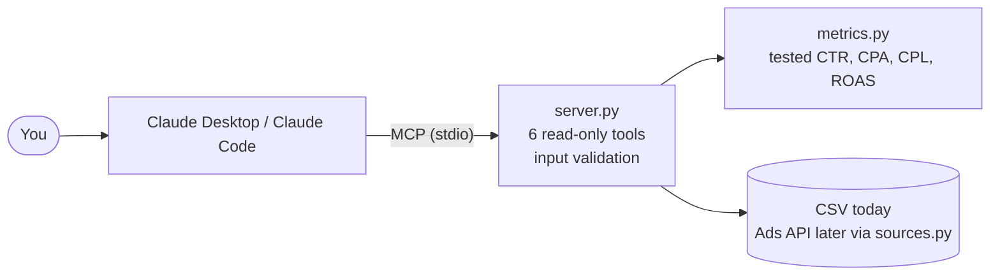

# Ad Performance MCP Server

**Ask Claude about your ad performance in plain English, and get answers from tested code, not guesses.**

A small, read-only [MCP](https://modelcontextprotocol.io) server. It reads campaign data and exposes six tools that Claude can call: spend, CPA, cost per lead, ROAS, period comparisons and a weekly summary.

> The included data is **synthetic** (see `generate_data.py`). Results on it are a demo, not benchmarks.

## The problem

Weekly ad reporting is repetitive. Export from each platform, paste into a sheet, rebuild the same formulas, then work out what to change. Asking a chat model to do this from pasted numbers is risky, because it can miscalculate ratios or invent a figure.

This server gives Claude a fixed set of tools instead. The maths lives in tested Python, the rules (target CPA, target CPL) are explicit, and nothing can change an account.

## How it works



Plain-text version: `You -> Claude -> (MCP over stdio) -> server.py -> metrics.py + data`.

Claude decides which tool to call. The tool validates the input, calculates the answer in code, and returns structured results. Claude then explains them.

## Tools

| Tool | What it does |
|---|---|
| `list_campaigns` | Campaigns, platforms, ad sets and the date range of the data |
| `get_campaign_metrics` | Spend, clicks, conversions, revenue, CTR, CPC, CPA, ROAS for one campaign and date range |
| `compare_periods` | Two periods side by side with percent change |
| `find_underperformers` | Ad sets with no conversions or CPA above your target, ranked by wasted spend |
| `cost_per_lead` | CPL by ad set, campaign or platform, worst first. With `target_cpl`, shows which groups are over target and how much spend was above it |
| `weekly_summary` | 7-day totals, results by platform, best and worst campaign, change vs previous week |

## Example prompts

- "What campaigns and date range do you have?"
- "Which ad sets have the highest cost per lead in October if my target is 40?"
- "Compare CPL by platform for October."
- "Which ad sets are wasting the most money if my target CPA is 100?"
- "Compare Retargeting - Site Visitors from 4 Sep to 1 Oct against 2 Oct to 29 Oct."
- "Give me a weekly summary starting 2026-10-20."

Example result from the synthetic data (`cost_per_lead` by platform, October):

| Platform | Spend | Leads | CPL |
|---|---|---|---|
| Google | 22,814.61 | 783 | 29.14 |
| Meta | 19,419.22 | 427 | 45.48 |
| TikTok | 6,613.55 | 46 | 143.77 |

Overall CPL was 38.89, which looked fine until it was split by platform.

## Safety

- **Read-only by design.** There is no tool that changes budgets, bids or campaign status. If you ask Claude to pause an ad, it has no way to do it.
- **Validated inputs.** Dates must be `YYYY-MM-DD` (formats like `10/01/26` are ambiguous, so they are rejected). Reversed ranges, ranges outside the data, unknown campaign names and bad numbers return a clear message, often with a suggestion.
- **Honest about gaps.** If only part of the requested period has data, the result says so.
- **Secrets stay out of git.** Keys go in `.env`, which is in `.gitignore`. Copy `.env.example` to `.env` when you add live APIs.
- **Data privacy.** Whatever a tool returns is sent to Claude. Check your client agreements before pointing this at real client data.

## Setup

Requires Python 3.10 or newer.

```powershell
python -m venv .venv
.venv\Scripts\activate            # macOS/Linux: source .venv/bin/activate
pip install -r requirements.txt
python generate_data.py           # creates data/ads_sample.csv (synthetic)
python run_tests.py               # runs all tests
python try_tools.py               # calls every tool once, no Claude needed
```

**Connect to Claude Desktop:**

```powershell
python make_claude_config.py                  # prints the config with your real paths
python make_claude_config.py --merge "<path to claude_desktop_config.json>"
python check_setup.py                         # diagnoses why Claude isn't loading it
```

Restart Claude Desktop afterwards. Or use the MCP Inspector: `mcp dev server.py`.

**Claude Code:**

```bash
claude mcp add ad-performance -- /ABSOLUTE/PATH/.venv/bin/python /ABSOLUTE/PATH/server.py
```

## Use your own data

Any CSV with these columns works: `date, platform, campaign, adset, spend, impressions, clicks, conversions, revenue`. Set `ADS_DATA_FILE` to its path. If the file has a `leads` column, `cost_per_lead` uses it. Otherwise it uses `conversions`, so check what that column means in your export (leads, purchases or something else).

Bad rows (blank, non-numeric or negative values) are rejected at startup with the CSV line number.

## Design choices

- **Logic is separate from the server** (`metrics.py`), so it is tested without MCP.
- **Logging goes to stderr.** Printing to stdout breaks the stdio connection.
- **Divide-by-zero safe.** A ratio with no denominator returns `null`, not a crash.
- **One data interface** (`sources.py`) so the CSV can be swapped for an API without touching the tools.

## Results

Measured on one person's weekly report, median of 3 runs each. See [docs/MEASURE.md](docs/MEASURE.md) for the method.

| | Before (manual) | After (with server) |
|---|---|---|
| Time to produce the weekly report | _to be measured_ | _to be measured_ |

## Roadmap

- [x] Read-only tools with input validation and tests
- [x] Cost per lead tool
- [ ] Live data from the Meta Marketing API or Google Ads API (`sources.py` has a Meta scaffold, **not yet tested against a real account**)
- [ ] Wire `sources.py` into `server.py` with caching and rate-limit handling
- [ ] Lead quality (cost per qualified lead) once a CRM column is available
- [ ] Demo video (script in [docs/DEMO_SCRIPT.md](docs/DEMO_SCRIPT.md))
